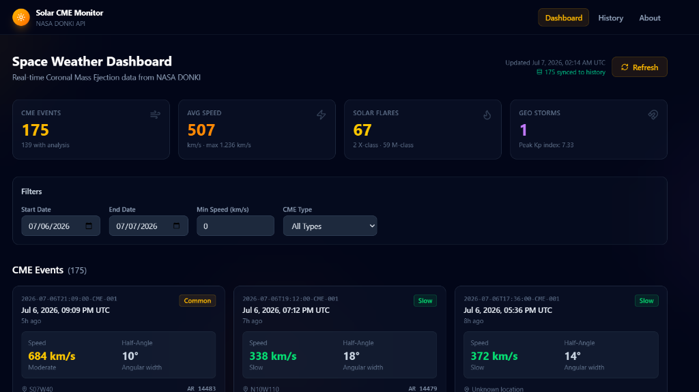
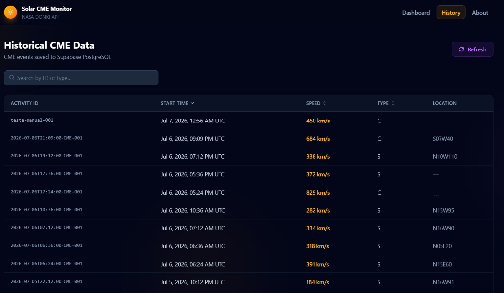

# Solar CME Monitor

<p align="center">
  
</p>

<p align="center">
  Search, visualize and persist Coronal Mass Ejection (CME) events from NASA's DONKI API.
</p>

<p align="center">


</p>

<p align="center">


</p>

<p align="center">
  <b>Demo video:</b>
</p>

https://github.com/user-attachments/assets/d337e975-9ac9-48da-b97e-fff1700133f5

<p align="center">
  <b>Click the buttons below to open the project:</b>
</p>

<p align="center">

<a href="https://solar-cme-monitor.vercel.app">

</a>

<a href="https://github.com/nasa-cme/cme-dashboard">

</a>

</p>

# Known Limitations

- This project uses Supabase's free tier, which automatically pauses the database after a period of inactivity. If the live demo appears unresponsive, the database may need a few seconds to resume, or manual reactivation may be required via the Supabase dashboard.

---

# Table of Contents

- About
- Why this project
- Screenshots
- Features
- Technology Stack
- Architecture
- Project Structure
- Getting Started
- Environment Variables
- Testing
- Deployment
- Roadmap
- License

---

# About

Solar CME Monitor is a web application built with React that allows users to search, visualize and persist Coronal Mass Ejection (CME) events from NASA's DONKI API.

The project focuses on modern frontend architecture, API integration, cloud databases and secure server-side communication using Supabase Edge Functions.

---

# Technical Focus

This project was architected to showcase modern web development standards, specifically focusing on:

- React application architecture and state management
- Secure REST API integration and proxying
- Cloud database design (PostgreSQL)
- Serverless backend implementation (Supabase Edge Functions)
- Responsive UI/UX development
- Automated testing with Vitest and Testing Library
- CI/CD pipelines with GitHub Actions

---

# Screenshots

## Dashboard



## History



---

# Features

- ✅ Search CME events by date range
- ✅ NASA DONKI API integration
- ✅ Secure API proxy using Supabase Edge Functions
- ✅ Event persistence in PostgreSQL
- ✅ Search history
- ✅ Responsive interface
- ✅ Error handling
- ✅ Charts and statistics
- ✅ Automated tests (Vitest + Testing Library)
- ⏳ CSV export
- ⏳ Advanced filters

---

# Technology Stack

| Layer | Technology |
|------|------------|
| Frontend | React 19 |
| Build Tool | Vite |
| Language | JavaScript (ES6+) |
| Styling | CSS3, Tailwind CSS |
| Database | PostgreSQL (Supabase) |
| Backend | Supabase Edge Functions |
| Runtime | Deno |
| API | NASA DONKI API |
| Testing | Vitest, Testing Library |
| Deployment | Vercel |
| CI/CD | GitHub Actions |
| Version Control | Git & GitHub |

---

# Architecture

```
Client Browser
      │
      ▼
React Application
      │
 ┌────┴────┐
 │         │
 ▼         ▼
Edge Function     Supabase Database
      │               │
      ▼               ▼
NASA DONKI API   CME Events / History
```

The React application communicates with a Supabase Edge Function, which securely forwards requests to NASA's DONKI API while protecting the API key from client exposure. Retrieved data can then be stored and queried from the Supabase PostgreSQL database.

---

# Project Structure

```
solar-cme-monitor/
│
├── public/
├── src/
│   ├── components/
│   │   ├── __tests__/
│   │   ├── cme/
│   │   ├── layout/
│   │   └── ui/
│   ├── hooks/
│   ├── pages/
│   ├── services/
│   ├── test/
│   ├── utils/
│   │   └── __tests__/
│   ├── App.jsx
│   └── main.jsx
│
├── supabase/
│   ├── functions/
│   └── migrations/
│
├── .env.example
├── package.json
└── README.md
```

---

# Getting Started

## Prerequisites

- Node.js 18+
- Supabase account
- NASA API Key

## Installation

```bash
git clone https://github.com/nasa-cme/cme-dashboard.git
cd cme-dashboard
npm install
npm run dev
```

The development server will be available at:

```
http://localhost:5173
```

---

# Environment Variables

Create a `.env.local` file.

```env
VITE_SUPABASE_URL=
VITE_SUPABASE_ANON_KEY=
```

Configure the NASA key in Supabase:

```bash
supabase secrets set NASA_API_KEY=your_key
```

---

# Testing

The project includes an automated test suite built with **Vitest** and **Testing Library**, covering pure utility functions and UI components.

```bash
npm test              # run once
npm run test:watch    # watch mode
npm run test:coverage # with coverage report
```

What is covered:

* **Formatters** (`utils/formatters.js`) — date formatting, `timeAgo` with fake timers, speed formatting and locale handling, angle formatting, flare class extraction, and max Kp index calculation
* **Constants** (`utils/constants.js`) — structural invariants the rest of the app depends on: threshold ordering, required keys in type/color maps, storm level sort order, and nav item shape
* **Badge component** — renders children, applies correct variant classes, falls back to default for unknown variants, and merges custom `className` props

Tests run fully offline: no NASA API key, no Supabase connection, and no network access is required to run the suite.

---

# Deployment

The application is deployed on Vercel.

Every push to the `main` branch automatically triggers a production deployment.

Production URL:

```
https://solar-cme-monitor.vercel.app
```

---

# Roadmap

- [x] NASA API integration
- [x] Supabase database
- [x] Responsive UI
- [x] Statistics dashboard
- [x] Charts
- [x] Automated tests
- [ ] CSV export
- [ ] Advanced filtering
- [ ] Performance optimizations

---

